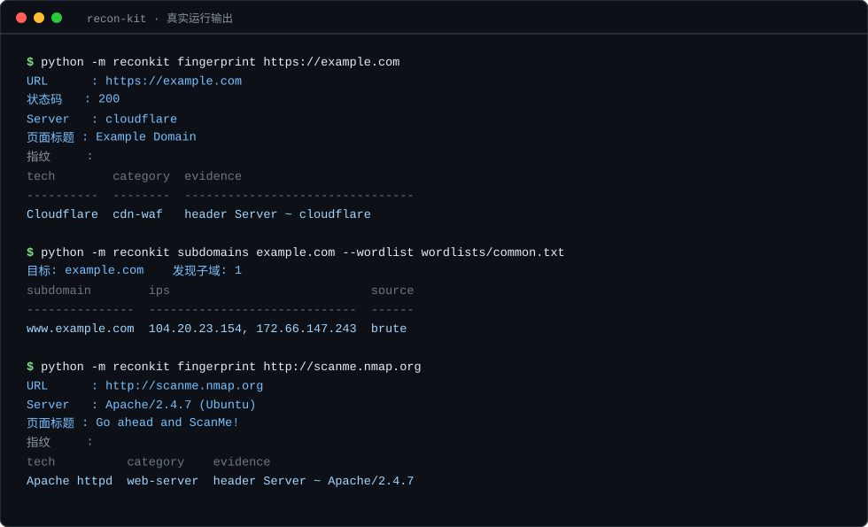

# recon-kit

> 轻量级资产侦察工具：**子域名枚举** + **技术栈指纹识别**，只依赖 Python 标准库。

[](https://github.com/Ph629-max/recon-kit/actions/workflows/ci.yml)
[](#)
[](LICENSE)
[](#)



> 上图为**真实运行输出**（目标为公开示例站点与授权练习靶机）。

## 为什么写这个

安全测试的第一阶段是**资产测绘**：先搞清楚目标有哪些入口、跑的是什么技术栈。现成工具很多，但各有取舍：

- 有的功能强但依赖几十个第三方库，环境难复现；
- 有的只管爆破、不管结果组织，输出难以直接进报告。

recon-kit 的目标是**小而完整**：**零第三方依赖**（运行时只用标准库）、输出可直接贴进报告、规则可自定义、每个模块都能单测。

## 特性

| 能力 | 说明 |
|------|------|
| 子域名枚举 | 被动：证书透明度日志（crt.sh）；主动：字典并发解析 |
| 并发解析 | 线程池 + 可调超时，默认 20 线程 |
| 指纹识别 | 35 条内置规则，覆盖 Web 服务器 / 框架 / 语言 / CMS / 中间件 / CI / CDN-WAF / 面板 |
| 自定义规则 | 规则是 JSON，可自行扩充 |
| 多种输出 | 终端对齐表格 / JSON（方便二次处理） |
| 举证式证据 | 每个命中都附带**匹配到的原始片段**，避免"猜测式"结论 |
| 离线可测 | 单元测试全程不发网络请求 |

## 快速开始

```bash
# 无需安装依赖，克隆即用
git clone https://github.com/Ph629-max/recon-kit.git
cd recon-kit

# 查看帮助
python -m reconkit --help
```

### 安装为命令（可选）

```bash
pip install .

# 安装后可直接使用 reconkit 命令
reconkit --version
reconkit fingerprint https://example.com
```

### 子域名枚举

```bash
# 纯被动（查证书透明度日志，不接触目标）
python -m reconkit subdomains example.com

# 被动 + 字典爆破
python -m reconkit subdomains example.com --wordlist wordlists/common.txt --threads 30

# JSON 输出，便于管道处理
python -m reconkit subdomains example.com --json > subs.json
```

输出示例：

```
目标: example.com    发现子域: 3
subdomain        ips             source
---------------  --------------  ---------
api.example.com  203.0.113.10    crt.sh
dev.example.com  203.0.113.11    brute
www.example.com  203.0.113.12    crt.sh
```

### 指纹识别

```bash
# 单个目标
python -m reconkit fingerprint https://example.com

# 批量
python -m reconkit fingerprint https://a.example.com https://b.example.com --json

# 使用自定义规则
python -m reconkit fingerprint https://example.com --rules my-rules.json
```

输出示例：

```
URL      : https://example.com
状态码   : 200
Server   : nginx/1.24.0
页面标题 : Example Domain
指纹     :
tech     category      evidence
-------  ------------  ------------------------------
Nginx    web-server    header Server ~ nginx/1.24.0
```

## 规则文件格式

```json
[
  {
    "name": "ThinkPHP",
    "category": "framework",
    "headers": { "X-Powered-By": "ThinkPHP[^ ]*" },
    "body": ["thinkphp"],
    "cookies": ["think_lang|think_var"],
    "title": ["ThinkPHP"]
  }
]
```

| 字段 | 说明 |
|------|------|
| `name` / `category` | 技术名 / 分类（用于分组展示） |
| `headers` | 响应头匹配：`{"头名": "正则"}` |
| `body` | 响应体正则列表 |
| `cookies` | Set-Cookie 正则列表 |
| `title` | 页面标题正则列表 |

**任一维度命中即算匹配**，并在 `evidence` 中给出命中的原始片段。

## 目录结构

```
recon-kit/
├── reconkit/
│   ├── cli.py              # 命令行入口（argparse 子命令）
│   ├── netutil.py          # 域名归一化 / DNS 解析 / HTTP GET / 标题提取
│   ├── subdomain.py        # 子域枚举：crt.sh 解析 + 并发爆破
│   ├── fingerprint.py      # 指纹匹配引擎
│   ├── report.py           # 表格 / Markdown / JSON 渲染
│   └── rules/
│       └── fingerprints.json
└── tests/
    └── test_reconkit.py    # 离线单元测试
```

## 测试

```bash
pip install -r requirements-dev.txt
pytest -q
```

另有**离线冒烟测试**，用本地 HTTP 服务验证完整链路（不访问外网）：

```bash
python tests/smoke_offline.py
```

CI 会在 Python 3.8 ~ 3.13 六个版本上跑上面全部测试，并额外验证包可正常构建安装。

测试覆盖：域名归一化、DNS/IP 判断、title 提取、crt.sh 响应解析（含畸形输入）、子域过滤、规则匹配（命中/未命中/举证）、表格与 JSON 渲染、默认规则文件完整性。**全部离线**，CI 可直接跑。

## 设计取舍

1. **只用标准库**：`urllib` 代替 `requests`，`socket` 代替 `dnspython`。代价是拿不到 TXT/CNAME 记录，但换来"克隆即用、无依赖冲突"。
2. **不抛异常**：批量扫描时任何网络错误都走返回值里的 `error` 字段，而不是中断整个任务。
3. **举证优先**：宁可少报，也要每条命中都能给出原始片段 —— 安全结论没有证据就是猜。
4. **被动优先**：默认先查证书透明度日志（不接触目标主机），需要时才启用字典爆破。
5. **不把"失败"伪装成"没有结果"**：被动数据源故障（如 crt.sh 返回 HTTP 502）必须**显式暴露**。
   否则使用者会把服务端故障误读成"该域名没有子域记录" —— 这比直接报错更危险。
   因此被动查询返回结构化的 `error`，CLI 打印 `[!]` 告警，JSON 输出含 `warnings` 字段。
   > 该问题由一次真实目标测试暴露：先加**对照组**（同时测一个已知域名）才确认是数据源故障，而非"无数据"。

## 合规声明

本工具仅用于**自有资产**或**已获得书面授权**的安全测试、资产盘点与防御加固。

使用者需自行确保测试行为符合当地法律法规及目标方的授权范围。作者不对任何未授权使用承担责任。请勿将本工具用于扫描你不拥有或未获授权的系统。

## Roadmap

- [ ] TLS 证书信息采集（颁发者、SAN、有效期）
- [ ] 端口存活快速探测
- [ ] 结果导出为 Markdown 报告
- [ ] 支持 CNAME/TXT 记录（可选依赖 `dnspython`）

## License

[MIT](LICENSE)
